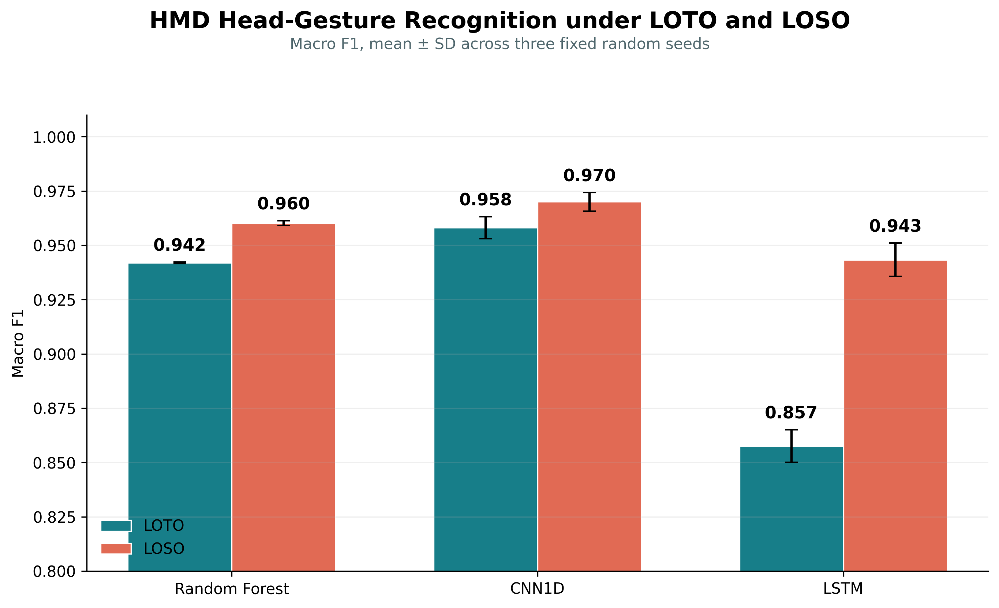

# Head-gesture recognition from HMD sensors

Can a VR headset recognize deliberate head gestures, using only its own motion sensors, well enough to serve as hands-free input?

## The experiment

- **Data collection.** Eight participants performed six deliberate head gestures while wearing a Meta Quest 3. A Unity app (`unity/`) logged head pose at 50 Hz. Each gesture was cut into a three-second window: 8 participants × 3 trials × 6 gestures × 10 repetitions = 1,440 windows.
- **Input.** Each window is a 150 × 6 sequence: three Euler angles relative to the starting pose and three angular-velocity channels.
- **Models.** Random Forest on 48 statistical features (8 per channel), versus CNN1D and LSTM trained directly on the standardized sequences.
- **Evaluation.**
  - **LOTO** (leave-one-trial-out): test on an unseen trial of a participant seen in training.
  - **LOSO** (leave-one-subject-out): test on a participant never seen in training.
  - Test folds were never used for scaling, validation or early stopping. Results are averaged over three seeds.

## Results (macro F1, mean of 3 seeds)

| Model | LOTO | LOSO |
|---|---|---|
| CNN1D | **0.958** | **0.970** |
| Random Forest | 0.942 | 0.960 |
| LSTM | 0.857 | 0.943 |

CNN1D was best under both protocols, and all three models exceeded 0.85.



An earlier version of the analysis pooled all windows and used stratified 5-fold cross-validation (`kdcs_5fold/`). Its scores are higher (CNN1D 0.986), but the same participant's data can appear in both training and test folds, which can inflate scores. For this reason the LOTO/LOSO version above is the main one.

## Repository layout

```
iwcs_loto_loso/   main LOTO/LOSO analysis and figure script (+ supplementary tuning/diagnostics)
kdcs_5fold/       earlier pooled 5-fold analysis (scripts 01–08)
unity/            Unity C# scripts used to record head pose on Meta Quest 3
results/          aggregate metrics only (per model / fold / seed)
figures/          result figures
MAPPING.md        which script produces which number, and how to run it
DATA_NEEDED.md    expected input files and columns
```

Example (see `MAPPING.md`):

```
python iwcs_loto_loso/unified_loto_loso_analysis.py --datasets dataset_A --sequence-length 150 --seeds 42 43 44 --epochs 60
```

## Data

The recorded sensor data are not included because they come from human participants. `DATA_NEEDED.md` describes the CSV format that the scripts expect, so the pipeline can be run on newly recorded data.

Python with NumPy, pandas, scikit-learn and TensorFlow/Keras; Unity with OpenXR for data collection. This was a team project at INC LAB; this repository contains the analysis code and the data-collection scripts.
